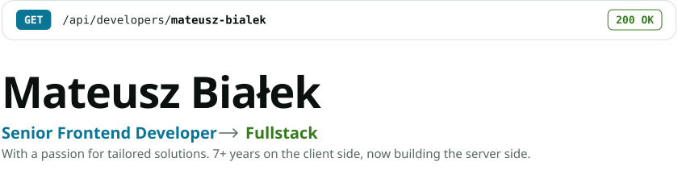
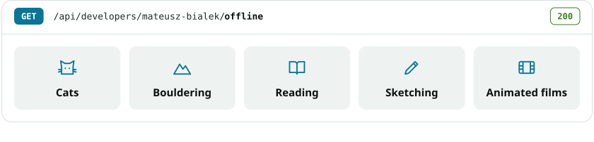
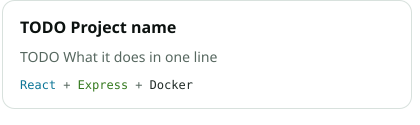
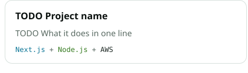

<!-- Generated by `npm run build` from profile.config.ts and data/stack.json. Edit those, not this file. -->

<picture><source media="(prefers-color-scheme: dark)" srcset="./assets/dark/header.svg"></picture>
<picture><source media="(prefers-color-scheme: dark)" srcset="./assets/dark/lifecycle.svg"></picture>
<picture><source media="(prefers-color-scheme: dark)" srcset="./assets/dark/response.svg"></picture>
<picture><source media="(prefers-color-scheme: dark)" srcset="./assets/dark/stack.svg"></picture>
<picture><source media="(prefers-color-scheme: dark)" srcset="./assets/dark/offline.svg"></picture>
<picture><source media="(prefers-color-scheme: dark)" srcset="./assets/dark/projects.svg"></picture>
<picture><source media="(prefers-color-scheme: dark)" srcset="./assets/dark/project-1.svg"></picture><picture><source media="(prefers-color-scheme: dark)" srcset="./assets/dark/project-2.svg"></picture>
<a href="mailto:mateusz.d.bialek@gmail.com"><picture><source media="(prefers-color-scheme: dark)" srcset="./assets/dark/contact.svg"></picture></a>

